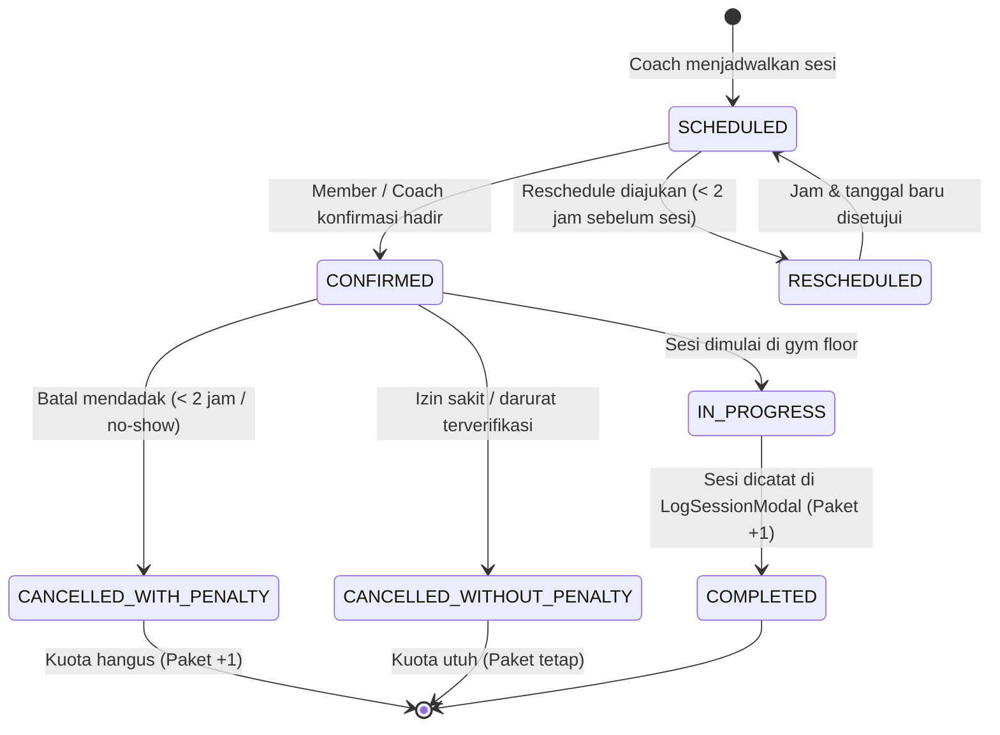
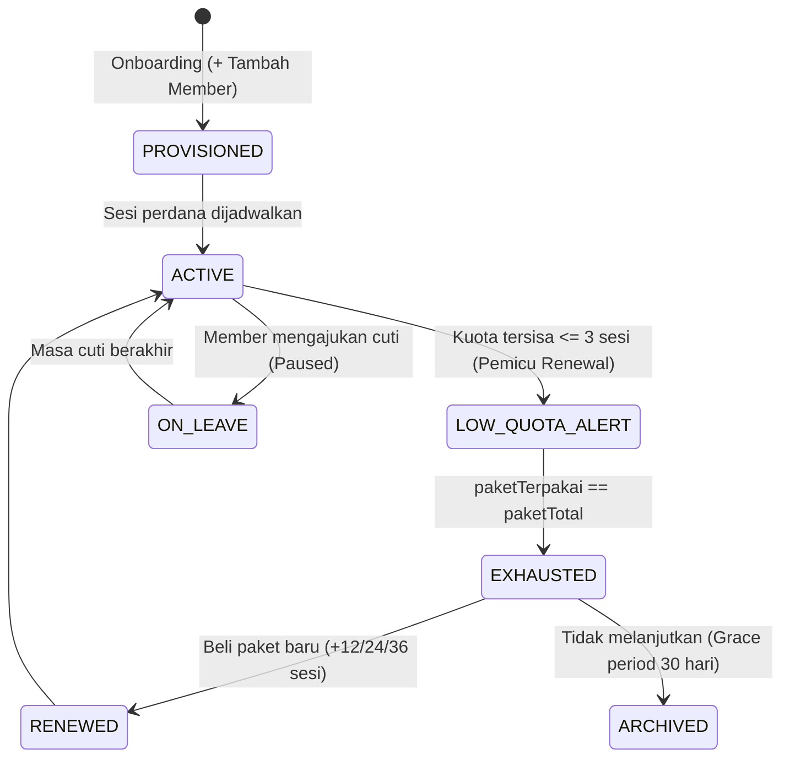
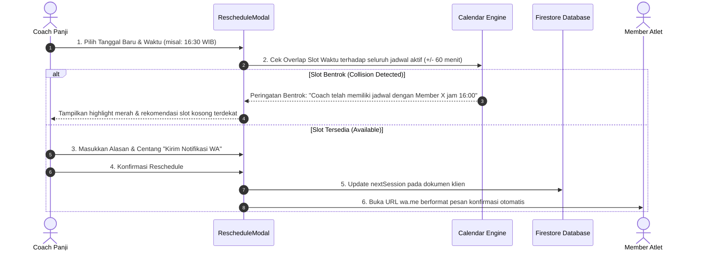

# PelatihKu PRO — System Design Document
**Athletic Coaching Operating System**  
**Version:** 2.5.0 | **Date:** November 2026 | **Status:** Active & Production-Ready  
**Lead Coach:** Panji Akbar Syamsi, S.Or. (Master Fitness Trainer)

---

## Daftar Isi (Table of Contents)

1. [Executive Summary & Product Vision](#1-executive-summary--product-vision)
2. [High-Level Architecture Overview](#2-high-level-architecture-overview)
3. [Technology Stack](#3-technology-stack)
4. [Core System Modules & Component Hierarchy](#4-core-system-modules--component-hierarchy)
5. [Data Architecture & Schema Specifications](#5-data-architecture--schema-specifications)
6. [Business Logic, Invariant Rules & Mathematical Calculations](#6-business-logic-invariant-rules--mathematical-calculations)
7. [State Machines & Lifecycle Transitions](#7-state-machines--lifecycle-transitions)
8. [Decision Trees & Multi-Actor Process Flows](#8-decision-trees--multi-actor-process-flows)
9. [Authentication & Security Architecture](#9-authentication--security-architecture)
10. [AI Engine & Sports Science Integration (Gemini 2.5 Flash)](#10-ai-engine--sports-science-integration-gemini-25-flash)
11. [Offline-First Strategy & Gym Floor Resilience](#11-offline-first-strategy--gym-floor-resilience)
12. [Screen Map, Navigation & User Flows](#12-screen-map-navigation--user-flows)
13. [Persona Auth, Screen Access, Data Scope & Feature Matrix](#13-persona-auth-screen-access-data-scope--feature-matrix)
14. [Edge Cases, Boundary Limits & Failure Recovery](#14-edge-cases-boundary-limits--failure-recovery)
15. [Firestore Security Rules & RBAC Strategy](#15-firestore-security-rules--rbac-strategy)
16. [Comprehensive Test & QA Verification Plan (BDD / Gherkin)](#16-comprehensive-test--qa-verification-plan-bdd--gherkin)
17. [Non-Functional Requirements (NFR) & UX Standards](#17-non-functional-requirements-nfr--ux-standards)
18. [Deployment & Infrastructure Topology](#18-deployment--infrastructure-topology)

---

## 1. Executive Summary & Product Vision

**PelatihKu PRO** adalah aplikasi web progresif (Progressive Web App - PWA) *mobile-first* berkelas industri yang dibangun khusus sebagai **Sistem Operasi Manajemen Kepelatihan Atletik & Personal Training (PT)** di gym komersial dan studio privat (*Fitness Center Senayan, SCBD District 8, Kemang Private Studio*).

### Masalah Utama yang Diselesaikan:
1. **Pencatatan Manual yang Tidak Efisien:** Pelatih sering menggunakan kertas, buku memo, atau aplikasi spreadsheet yang lambat di lantai gym.
2. **Konektivitas Lantai Gym Buruk (Dead Zone):** Sinyal seluler dan Wi-Fi di basement/gym floor sering putus, menyebabkan aplikasi berbasis cloud murni terhenti (*freeze*).
3. **Risiko Keamanan & Cedera:** Kurangnya akses cepat terhadap screening postur (FMS) dan riwayat medis lampau member sebelum latihan angkat beban majemuk (*compound lifts*).
4. **Kebocoran Kuota Sesi:** Sesi member sering tidak terhitung akurat, menimbulkan selisih administrasi paket member.

### Solusi PelatihKu PRO:
- **Alur Kerja Cepat (< 45 detik):** Pencatatan set, repetisi, RPE, dan deteksi PR instan di sela waktu istirahat set (*rest interval*).
- **Toleransi Kegagalan Offline 100%:** Mengombinasikan Firebase Firestore real-time listener dengan fallback otomatis ke `localStorage` dan Sports Science Engine internal.
- **Asistensi Kepelatihan Cerdas:** Integrasi Gemini 2.5 Flash untuk pembuatan periodisasi 4 minggu, evaluasi FMS, regresi latihan kelelahan (DOMS), dan penyusunan laporan WhatsApp otomatis.

---

## 2. High-Level Architecture Overview

Sistem menggunakan pola arsitektur **Client-Centric PWA with Real-Time BaaS & Stateless AI Proxy Service**:

```
┌─────────────────────────────────────────────────────────────────────────────────────────┐
│                                CLIENT TIER (Progressive Web App)                        │
│                                                                                         │
│   ┌─────────────────────────────────────────────────────────────────────────────────┐   │
│   │                              React 19 Presentation Layer                        │   │
│   │   [LoginScreen] [Executive Dashboard] [ClientDetailView] [SessionsCalendarView] │   │
│   │   [CoachProfileView] [LogSessionModal] [UpdateMetricsModal] [RescheduleModal]   │   │
│   └────────────────────────────────────────┬────────────────────────────────────────┘   │
│                                            │                                            │
│   ┌────────────────────────────────────────▼────────────────────────────────────────┐   │
│   │                             State & Optimistic Layer                            │   │
│   │    - React Hooks & Local State (useState, useMemo, useRef)                      │   │
│   │    - Service Worker Cache (public/sw.js) & PWA Engine                           │   │
│   │    - LocalStorage Cache Mirror ('pelatihku_v45_clients', 'pelatihku_v45_coach')  │   │
│   └────────────────────────────────────────┬────────────────────────────────────────┘   │
│                                            │                                            │
│   ┌────────────────────────────────────────▼────────────────────────────────────────┐   │
│   │                               Service Abstraction                               │   │
│   │   - firestoreService.ts (CRUD & Real-time onSnapshot Synchronization)            │   │
│   │   - geminiService.ts (Client API caller + Rule-based Offline Sports Engine)     │   │
│   │   - authGatekeeperService.ts (E.164 sanitization + PIN token client)            │   │
│   └───────────────────────┬──────────────────────────────────┬──────────────────────┘   │
└───────────────────────────┼──────────────────────────────────┼──────────────────────────┘
                            │ WebSocket / gRPC                 │ REST (JSON over HTTP)
                            │ (onSnapshot Listener)            │ (Timeout: 12-15s)
                            ▼                                  ▼
┌──────────────────────────────────────┐  ┌───────────────────────────────────────────────┐
│      FIREBASE BACKEND (BaaS)         │  │         NODE / EXPRESS SERVER (server.ts)     │
│                                      │  │                                               │
│  ┌────────────────────────────────┐  │  │  - Health Check: GET /api/health              │
│  │ Cloud Firestore Database       │  │  │  - Periodization: POST /api/ai/periodization  │
│  │  ├── clients/{clientId}        │  │  │  - Screening FMS: POST /api/ai/screening      │
│  │  ├── coach_profile/{profileId} │  │  │  - Workout Assist: POST /api/ai/workout-assist│
│  │  ├── users/{userId}            │  │  │  - WA Report: POST /api/ai/report             │
│  │  └── internal_auth/{doc}       │  │  │  - Static Asset Hosting (/dist fallback)      │
│  └────────────────────────────────┘  │  └───────────────────────┬───────────────────────┘
│                                      │                          │ Google GenAI SDK
│  ┌────────────────────────────────┐  │                          ▼
│  │ Firebase Auth & Custom Claims  │  │  ┌───────────────────────────────────────────────┐
│  │ (role: 'coach' | 'client')     │  │  │         GEMINI 2.5 FLASH CLOUD MODEL          │
│  └────────────────────────────────┘  │  │    (Generative Sports Science Engine)         │
└──────────────────────────────────────┘  └───────────────────────────────────────────────┘
```

---

## 3. Technology Stack

| Layer | Pilihan Teknologi | Versi | Justifikasi Arsitektur |
|---|---|---|---|
| **Frontend Framework** | React | `19.0.1` | Performa re-render cepat, compiler optimasi mutakhir, concurrency handling. |
| **Build Tooling** | Vite | `8.3.0` | Hot Module Replacement (HMR) sub-milidetik, bundle splitting optimal. |
| **CSS & Design System** | Tailwind CSS | `4.3.3` | Utility-first, compile time instan via `@tailwindcss/vite`, styling OLED dark mode. |
| **Motion & Animation** | Motion (Framer) | `12.23.24` | Micro-interactions halus pada feedback sentuhan dan modal transitions. |
| **Iconography** | Lucide React | `0.546.0` | Ikon SVG berbobot ringan, konsisten, dan komprehensif. |
| **Language & Typings** | TypeScript | `7.0.2` / `5.x` | Kontrak tipe data ketat di seluruh profil atletik, sesi, dan metrik tubuh. |
| **Database & Sync** | Cloud Firestore | `firebase@13.2.0` | Real-time push synchronization dengan listener `onSnapshot` & offline cache. |
| **Auth System** | Firebase Auth + PIN Gatekeeper | Hybrid | Biometrik (WebAuthn/TouchID), 6-digit PIN cepat, dan WhatsApp E.164. |
| **Backend AI Runtime** | Express.js + tsx | `4.21.2` / `4.21.0` | Proxy server aman menyembunyikan `GEMINI_API_KEY` dari client bundle. |
| **LLM Engine** | Google Gemini 2.5 Flash | `@google/genai@2.4.0` | Kecepatan inferensi tinggi, latensi rendah, output terstruktur NSCA/ACSM. |
| **Quality & E2E Test** | Playwright | `1.64.1` | Pengujian otomasi end-to-end, interaksi tap modal, dan offline testing. |

---

## 4. Core System Modules & Component Hierarchy

### 4.1 Struktur Hirarki Komponen Frontend

```
src/
├── main.tsx                         # Entry point aplikasi & mounting React DOM
├── index.css                        # Styling global, font, background OLED #0B0F17
├── App.tsx                          # Root Orchestrator (State, Filters, Handlers, Layout)
│
├── components/
│   ├── LoginScreen.tsx              # Autentikasi biometrik, PIN pad, & tab email
│   ├── ClientDetailView.tsx         # Profil mendalam member (5 tabbed view)
│   ├── SessionsCalendarView.tsx     # Kalender interaktif (Day, Week, Month view)
│   ├── CoachProfileView.tsx         # Portofolio lisensi, spesialisasi, & manajemen kuota
│   ├── LogSessionModal.tsx          # Pencatatan set-by-set latihan & deteksi PR
│   ├── UpdateMetricsModal.tsx       # Kalibrasi berat badan, body fat %, & antropometri
│   └── RescheduleModal.tsx          # Penjadwalan ulang sesi & notifikasi WhatsApp otomatis
│
├── data/
│   └── mockData.ts                  # Kontrak interface data atletik & initial data seed
│
├── hooks/
│   ├── usePwaInstall.ts             # PWA installation prompt lifecycle handler
│   └── useOptimisticClientUpdate.ts # Hook mutasi optimis lokal sebelum sinkronisasi cloud
│
└── services/
    ├── firebase.ts                  # Inisialisasi Firebase App & instance Firestore
    ├── firestoreService.ts          # Abstraksi query, batch writes, & live listener
    ├── geminiService.ts             # Gateway AI Gemini + Offline Sports Engine fallback
    └── authGatekeeperService.ts     # Client sanitasi E.164 & komunikasi token Gatekeeper
```

---

## 5. Data Architecture & Schema Specifications

### 5.1 Skema Koleksi Firestore

#### Koleksi 1: `clients/{clientId}`
Dokumen individual per member yang memuat rekam medis, antropometri, sesi, dan progres.

```typescript
interface ClientProfile {
  id: string;                         // Unique ID ("k-01" atau timestamp "k-1730812345678")
  code: string;                       // Kode registrasi resmi ("#KLN-2026-081")
  nama_lengkap: string;               // Nama lengkap member
  gender: 'Pria' | 'Wanita';
  usia: number;
  pekerjaan: string;
  telepon: string;                    // Format internasional E.164 ("6281234567890")
  target_utama: string;               // Ringkasan target ("Fat Loss -5.0kg")
  target_category: 'Fat Loss' | 'Hipertrofi' | 'Powerlifting';
  phase: string;                      // Fase periodisasi saat ini ("Hypertrophy Mesocycle II")
  status: 'Aktif' | 'Cuti';
  initials: string;                   // 2 huruf inisial avatar
  avatarBg: string;                   // Gradient CSS Tailwind
  paketTotal: number;                 // Kuota sesi yang dibeli (12, 24, 36)
  paketTerpakai: number;              // Jumlah sesi selesai (0 <= paketTerpakai <= paketTotal)
  dietCompliancePct: number;          // Skor kepatuhan diet mingguan (0-100%)
  leadCoach: string;                  // "Panji Akbar Syamsi"

  // Biometrik & Antropometri (Baseline Awal vs Terkini)
  berat_awal_kg: number;
  berat_terkini_kg: number;
  berat_target_kg: number;
  body_fat_awal_pct: number;
  body_fat_terkini_pct: number;
  massa_otot_awal_kg: number;
  massa_otot_terkini_kg: number;
  lingkar_pinggang_awal_cm: number;
  lingkar_pinggang_terkini_cm: number;
  lingkar_dada_awal_cm: number;
  lingkar_dada_terkini_cm: number;
  lingkar_lengan_awal_cm: number;
  lingkar_lengan_terkini_cm: number;
  visceralFatScore: number;           // Skor lemak visceral (1-20)

  // Target Makronutrisi & Hidrasi
  kaloriHarian: number;
  kaloriTarget: number;
  proteinHarian: number;
  proteinTarget: number;
  karboTarget?: number;
  lemakTarget?: number;
  hidrasiLiter: number;
  hidrasiTarget: number;
  weeklyNutritionDays: ('tercapai' | 'longgar' | 'terlewat')[];
  nutritionCoachNote: string;
  dietDetailNote?: string;

  // Screening Medis & Postur
  medicalHistoryNote?: string;
  postureScreeningNote?: string;

  // Referensi Foto Awal
  baselinePhotoUrl?: string;
  baselinePhotoPose?: string;
  baselinePhotoDate?: string;

  // Penjadwalan & Array Relasional Tersemat
  nextSession: {
    date: string;                     // Format "YYYY-MM-DD"
    time: string;                     // Format "HH:mm" (WIB)
    focus: string;                    // Fokus sesi
    location: 'Gym Utama Senayan' | 'SCBD District 8' | 'Private Studio Kemang';
    confirmed: boolean;
    rescheduleReason?: string;
  };
  sesi_terakhir: string;
  weeklyTrend: Array<{
    weekLabel: string;
    weightKg: number;
    bodyFatPct: number;
    muscleMassKg: number;
    waistCm: number;
  }>;
  prList: Array<{
    id: string;
    exerciseName: string;
    category: 'Free Weights' | 'Kabel/Mesin' | 'Kalistenik';
    weightKg: number;
    reps: number;
    est1RM: number;
    deltaKg: number;
    achievedDate: string;
    note: string;
  }>;
  sessions: Array<{
    id: string;
    sessionNumber: number;
    date: string;
    time: string;
    durationMinutes: number;
    focus: string;
    status: 'Hadir' | 'Batal/Izin' | 'Reschedule';
    rpe: number;
    totalVolumeKg: number;
    readiness: {
      energy: number;
      sleepHours: number;
      doms: 'Rendah' | 'Sedang' | 'Tinggi';
    };
    coachNotes: string;
    location: string;
    exercises: Array<{
      id: string;
      name: string;
      category: 'Free Weights' | 'Kabel/Mesin' | 'Kalistenik';
      tempo: string;
      restSeconds: number;
      historicalBestKg: number;
      sets: Array<{
        id: string;
        setNumber: number;
        type: 'Warm-up' | 'Work Set' | 'Top Set' | 'Drop Set';
        weightKg: number;
        reps: number;
        isPR?: boolean;
      }>;
    }>;
  }>;
  photos: Array<{
    id: string;
    weekLabel: string;
    date: string;
    weightKg: number;
    bodyFatPct: number;
    waistCm: number;
    pose: string;
    lightingNote: string;
    customImageUrl?: string;
  }>;
  updatedAt?: string;
}
```

#### Koleksi 2: `coach_profile/{profileId}`
Dokumen singleton identitas Head Coach (`pas_profile`).
```typescript
interface CoachProfileData {
  id: string;
  name: string;                       // "Coach Panji Akbar Syamsi, S.Or."
  initials: string;                   // "PAS"
  roleTitle: string;                  // "Head Coach & Master Fitness Trainer"
  kemenporaId: string;                // Lisensi Kemenpora RI
  pabsiLicense: string;               // Lisensi PB PABSI
  experienceYears: number;            // Masa kepelatihan
  specialization: string;             // "Strength & Conditioning, Hypertrophy, Rehab"
  primaryLocation: string;            // "Gym Utama Senayan"
  secondaryLocation: string;          // "SCBD District 8"
  email: string;
  whatsapp: string;
  maxClientQuota: number;             // Batas kuota atlet (cth: 27)
  acceptingNewClients: boolean;       // Toggle penerimaan member baru
  certifications: Array<{
    title: string;
    issuer: string;
    year: string;
  }>;
  updatedAt?: string;
}
```

---

## 6. Business Logic, Invariant Rules & Mathematical Calculations

Setiap mutasi data dalam PelatihKu PRO diatur oleh **Aturan Invarian Bisnis Matematis** berikut untuk menjaga integritas basis data atletik:

### 6.1 Formula & Invariant Matrix

| No | Komponen Bisnis | Formula Matematis | Batasan Invarian (Invariant Boundary) | Penanganan Pelanggaran (Violation Handler) |
|---|---|---|---|---|
| **1** | **Estimasi 1RM (Epley Formula)** | $\text{1RM} = \text{Beban} \times \left(1 + \frac{\text{Reps}}{30}\right)$ | $1 \le \text{Reps} \le 30$<br>$0.5 \le \text{Beban} \le 500\text{ kg}$ | Jika $\text{Reps} = 1$, $\text{1RM} = \text{Beban}$. Jika $\text{Reps} > 30$, sistem memblokir kalkulasi 1RM. |
| **2** | **Konsumsi Kuota Sesi PT** | $\text{Sisa} = \text{paketTotal} - \text{paketTerpakai}$ | $0 \le \text{paketTerpakai} \le \text{paketTotal}$ | Jika $\text{paketTerpakai} = \text{paketTotal}$, tombol *Catat Sesi* di-disable dengan peringatan *"Paket Selesai"*. |
| **3** | **Skor Kepatuhan Diet 7-Hari** | $\text{Compliance} = \left(\frac{\sum \text{Poin Hari}}{7}\right) \times 100\%$ | $0.0\% \le \text{Score} \le 100.0\%$ | Poin: `tercapai` = 1.0, `longgar` = 0.5, `terlewat` = 0.0. |
| **4** | **Kapasitas Kuota Pelatih** | $\text{Utilisasi} = \frac{\text{ActiveClients}}{\text{maxClientQuota}} \times 100\%$ | $\text{ActiveClients} \le \text{maxClientQuota}$ | Jika $\text{ActiveClients} \ge \text{maxQuota}$, toggle `acceptingNewClients` otomatis dikunci ke `false`. |
| **5** | **Ambang Batas Target Tercapai** | Fat Loss: $\Delta \ge 3.0\text{ kg}$<br>Hipertrofi: $\Delta \ge 2.0\text{ kg}$ | Nilai riil selisih $(\text{Awal} - \text{Terkini})$ | Dihitung dinamis untuk KPI Bento Dashboard tanpa hardcoding. |

---

## 7. State Machines & Lifecycle Transitions

### 7.1 Session Lifecycle State Machine



#### Aturan Transisi Ilegal (Illegal Transition Guards):
- ❌ DILARANG mengubah sesi dari `COMPLETED` kembali ke `SCHEDULED`.
- ❌ DILARANG mencatat set latihan pada sesi yang berstatus `CANCELLED`.
- ❌ Transisi ke `COMPLETED` wajib memvalidasi minimal 1 latihan dengan minimal 1 work set terisi.

### 7.2 Member PT Package Lifecycle State Machine



---

## 8. Decision Trees & Multi-Actor Process Flows

### 8.1 Alur Pencatatan Sesi & Deteksi Rekor PR Otomatis

```mermaid
sequenceDiagram
    autonumber
    actor Coach as Coach Panji (Gym Floor)
    participant UI as LogSessionModal (React 19)
    participant Engine as Sports Science Invariant Engine
    participant Cache as LocalStorage Mirror
    participant FS as Firestore (clients/{id})
    actor Member as Member (WhatsApp)

    Coach->>UI: 1. Input Set (Beban: 120kg, Reps: 5, RPE: 8.5)
    UI->>Engine: 2. Evaluasi Form & Ambang Batas 1RM
    Engine-->>UI: 3. Est. 1RM = 140kg (> Rekor Historis 135kg) -> Auto-check isPR = TRUE
    Coach->>UI: 4. Tap "Simpan Sesi & Konsumsi Kuota"
    
    rect rgb(20, 30, 45)
    Note over UI,Cache: Optimistic Local Phase (< 16ms)
    UI->>UI: 5. State Mutasi: paketTerpakai + 1, prList.unshift(newPR)
    UI->>Cache: 6. Simpan JSON ke 'pelatihku_v45_clients'
    UI-->>Coach: 7. Toast: "Sesi Berhasil Disimpan & PR 120kg Terdaftar!"
    end

    rect rgb(15, 35, 25)
    Note over UI,FS: Cloud Sync Phase (Background)
    UI->>FS: 8. setDoc(clientRef, sanitizedData, { merge: true })
    FS-->>UI: 9. Write Acknowledged
    end

    opt Jika Dicetuskan Laporan Otomatis
    UI->>Member: 10. Deep-link WA: Ringkasan Sesi & Pencapaian Rekor Baru
    end
```



### 8.2 Alur Reschedule & Resolusi Konflik Waktu



---

## 9. Authentication & Security Architecture

PelatihKu PRO mengimplementasikan pendekatan **Dual-Layer Defense**:
1. **Client-Side Session Locker:** Menjaga antarmuka PWA di lantai gym agar tidak bisa diakses orang lain saat perangkat ditinggal sejenak.
2. **Backend Gatekeeper & Firebase Custom Claims:** Validasi otentikasi kriptografis untuk mutasi database Cloud Firestore.
3. **Dynamic Phone-Derived Initial PIN & Client Profile Management:**
   - **Formula Penurunan PIN Otomatis:** Saat Coach mendaftarkan member baru, sistem mengekstrak 8 digit numerik terakhir dari nomor telepon:
     $$PIN_{initial} = \text{RegExpReplace}(\text{phone}, /\D/g, '')[-8:]$$
     Flag `mustChangePin: true` disematkan secara otomatis.
   - **Client Profile Screen (`ClientProfileView.tsx`):** Layar khusus persona atlet untuk memantau sisa paket, lead coach, status kredensial (`mustChangePin`), dan formulir ubah PIN mandiri (6–8 digit) dengan validasi anti-sekuensial dan konfirmasi instan.

```
                    ┌────────────────────────────┐
                    │       User Mengakses       │
                    │       Aplikasi PWA         │
                    └─────────────┬──────────────┘
                                  │
                                  ▼
                    ┌────────────────────────────┐
                    │   Periksa sessionStorage   │
                    │ pelatihku_session_active?  │
                    └──────┬──────────────┬──────┘
                           │              │
                   SUDAH AKTIF          TIDAK ADA
                           │              │
                           │              ▼
                           │    ┌────────────────────────┐
                           │    │  Buka LoginScreen.tsx  │
                           │    │  - Tab Biometrik / PIN │
                           │    │  - Tab Email & Sandi   │
                           │    └─────────┬──────────────┘
                           │              │
                           │         Verifikasi
                           │              │
                           │              ▼
                           │    ┌────────────────────────┐
                           │    │  Otentikasi Berhasil:  │
                           │    │  Set session_active    │
                           │    │  setIsLocked(false)    │
                           │    └─────────┬──────────────┘
                           │              │
                           ▼              ▼
                    ┌────────────────────────────┐
                    │   Buka Dashboard Utama     │
                    │   (Sinkronisasi Firestore) │
                    └────────────────────────────┘
```

---

## 10. AI Engine & Sports Science Integration (Gemini 2.5 Flash)

Aplikasi dilengkapi modul kecerdasan buatan berbasis **Gemini 2.5 Flash** yang di-hosting pada backend `server.ts` dengan perlindungan fallback offline mandiri di `geminiService.ts`.

### 10.1 Pipeline AI & Endpoint Mapping

| Endpoint Server | Fungsi Sports Science | Input Parameter | Output Terstruktur |
|---|---|---|---|
| `POST /api/ai/periodization` | Penyusunan periodisasi 4 minggu (Mesocycle) | `clientName, age, goal, experienceLevel, injuryHistory, sessionsPerWeek` | Rencana volume, intensitas % 1RM, RPE target, dan fase Deload mingguan. |
| `POST /api/ai/screening` | Analisis Movement Screening & biomekanika FMS | `clientName, fmsScore, postureNotes, mobilityFlags, priorInjuries` | Daftar kontraindikasi latihan (DILARANG), protokol korektif 5-7 menit, regresi aman. |
| `POST /api/ai/workout-assist` | Rekomendasi regresi beban latihan saat kelelahan | `exerciseName, fatigueScore (1-10), domsScore (1-10), muscleGroup, injuryNotes` | Keputusan aksi: Lanjutkan / Regresi 10-15% / Substitusi Latihan Mesin + Coaching Cues. |
| `POST /api/ai/report` | Generator laporan berkala WhatsApp profesional | `clientName, sessionsCompleted, targetSessions, currentWeight, baselineWeight, prMilestones` | Teks WhatsApp berformat tebal (*), poin ringkas, dan salam khas Coach Panji. |

### 10.2 Offline Sports Science Rule Engine
Jika server tidak dapat dihubungi atau perangkat berada di area tanpa internet (offline):
- `geminiService.ts` secara otomatis mencegat error via `AbortSignal.timeout` dan mengalihkan proses ke fungsi offline deterministik (`generateOfflinePeriodization`, `generateOfflineScreening`, `generateOfflineWorkoutAssist`, `generateOfflineReport`).
- Tidak ada fitur AI yang menyebabkan aplikasi *crash* atau menampilkan pesan kegagalan kosong kepada pelatih di lantai gym.

---

## 11. Offline-First Strategy & Gym Floor Resilience

```
               ┌────────────────────────────────────────────────────────┐
               │           Operasi Mutasi Data oleh Pelatih             │
               │   (Update Metrik, Catat Sesi Latihan, Jadwal Baru)     │
               └───────────────────────────┬────────────────────────────┘
                                           │
                                           ▼
               ┌────────────────────────────────────────────────────────┐
               │        1. Optimistic Local State Update                │
               │        - setClients() memperbarui UI instan (< 16ms)   │
               │        - Memberikan feedback visual tanpa jeda         │
               └───────────────────────────┬────────────────────────────┘
                                           │
                                           ▼
               ┌────────────────────────────────────────────────────────┐
               │        2. Local Storage Persistence Mirror             │
               │        - Simpan JSON ke 'pelatihku_v45_clients'        │
               │        - Menjamin data bertahan walau tab ditutup      │
               └───────────────────────────┬────────────────────────────┘
                                           │
                                           ▼
               ┌────────────────────────────────────────────────────────┐
               │        3. Background Cloud Firestore Write             │
               │        - saveClientToFirestore(sanitizedData)           │
               └───────────────┬────────────────────────┬───────────────┘
                               │                        │
                          ONLINE                   OFFLINE
                               │                        │
                               ▼                        ▼
                ┌─────────────────────┐   ┌──────────────────────────────┐
                │ Berhasil sinkron ke │   │ Masuk antrean Firestore SDK  │
                │ server Cloud        │   │ Offline Persistence Cache &  │
                │                     │   │ sync otomatis saat online    │
                └─────────────────────┘   └──────────────────────────────┘
```

---

## 12. Screen Map, Navigation & User Flows

```
[LoginScreen] ──(Biometrik / PIN / Kredensial)──► [Dashboard Utama]
                                                         │
         ┌───────────────────────────────────────────────┼────────────────────────────────────────┐
         │                                               │                                        │
         ▼                                               ▼                                        ▼
[Executive KPI Bento]                           [Direktori Member PT]                   [SessionsCalendarView]
 - Total Member Aktif                            - Pencarian (Ctrl+K)                    - Mode Hari (06-21)
 - Sesi Minggu Ini (Clickable)                   - Filter Status & Target                - Mode Minggu (Grid)
 - Target Tercapai                               - Tombol [+ Tambah Member]              - Mode Bulan (Matriks)
 - Kepatuhan Sesi Sparkline                              │                                        │
         │                                               ▼                                        │
         │                                      [ClientDetailView] ◄──────────────────────────────┘
         │                                       (5 Tab Informasi)
         │                                       ├── Tab 1: Ringkasan & Tren 8 Minggu
         │                                       ├── Tab 2: Riwayat Sesi & Board PR
         │                                       ├── Tab 3: Medis Lanjut & Makronutrisi
         │                                       ├── Tab 4: Nutrisi 7 Hari & Catatan Diet
         │                                       └── Tab 5: Dokumentasi Foto Fisik
         │                                               │
         │                        ┌──────────────────────┴──────────────────────┐
         ▼                        ▼                                             ▼
[CoachProfileView]      [UpdateMetricsModal]                                  [LogSessionModal]
 - Portofolio Lisensi   - Kalibrasi Berat                                     - Input Latihan Per Set
 - Utilisasi Kuota PT   - Kalibrasi Body Fat %                                - Repetisi, RPE & PR
 - Tombol Keluar Akun   - Antropometri Lingkar                                - Update Kuota Otomatis
```

---

## 13. Persona Auth, Screen Access, Data Scope & Feature Matrix

### 13.1 Persona 1: Head Coach & Personal Trainer (Lead Coach)
- **Metode Auth:** 1st: Biometrik (WebAuthn / Face ID), 2nd: PIN Cepat 6-Digit, 3rd: Email & Sandi.
- **Akses Layar:** Akses penuh ke seluruh layar, direktori, kalender, bento KPI, dan profil pelatih.
- **Data Scope:** Read & Write penuh ke `clients`, `coach_profile`, dan pembacaan akun `users`.
- **Fitur Spesial:** AI Periodization, AI Movement Screening, AI Workout Regression, dan WhatsApp Progress Report Generator.

### 13.2 Persona 2: Member / Client Fitness Center
- **Metode Auth:** 1st: WhatsApp OTP (E.164), 2nd: PIN 6-Digit (dengan `mustChangePin`), 3rd: Biometrik Perangkat.
- **Akses Layar:** `MemberDashboardView` (kuota sesi & tren pribadi), `MemberCalendarView` (sesi pribadi), `MemberNutritionView` (checklist makronutrisi), dan `MemberPRBoardView`.
- **Data Scope:** Hanya dokumen `clients/{clientId}` miliknya sendiri (`request.auth.uid == clientId`). DILARANG mengubah kuota paket atau membaca rekam medis/evaluasi internal coach.
- **Fitur Spesial:** Achievement Badges digital, Before-After Photo Slider, dan tombol direct message WhatsApp ke Coach Panji.

### 13.3 Persona 3: Gym Floor Admin / Manager
- **Metode Auth:** Email Perusahaan + Multi-Factor Authentication (MFA).
- **Akses Layar:** Dashboard utilisasi pelatih, pengaturan kuota maksimal pelatih, dan audit perpanjangan paket member.
- **Data Scope:** Read seluruh member dan pelatih; Write akun `users` dan status pembayaran paket.

---

## 14. Edge Cases, Boundary Limits & Failure Recovery

| Kasus Batas (Edge Case) | Gejala & Risiko | Invariant Guard & Mekanisme Pemulihan |
|---|---|---|
| **Pencatatan Sesi Saat Kuota Habis** | Kuota member terpotong melebihi kuota paket yang dibeli. | Tombol *Simpan Sesi* di-disable otomatis saat `paketTerpakai == paketTotal`, dan dialihkan ke pengajuan renewal paket. |
| **Double Tap Submit saat Sinyal Lemah** | Terjadi duplikasi pencatatan sesi dan pengurangan kuota ganda. | Penggunaan Idempotency Key berbasis `s-${date}-${clientId}` + proteksi state `isSubmitting = true`. |
| **Input Beban / Repetisi Tidak Valid** | Beban negatif atau repetisi 0 merusak grafik dan kalkulasi 1RM. | Form validation menolak `weightKg <= 0` atau `reps < 1` dengan feedback visual pada input field. |
| **Tabrakan Reschedule Dua Member** | Dua member dijadwalkan pada jam dan lokasi yang sama. | Engine kalender mengevaluasi slot waktu $\pm 60$ menit dan memunculkan notifikasi bentrok jadwal. |
| **Konflik Sinkronisasi Multi-Perangkat** | Data lama menimpa data baru saat kembali online. | Resolusi konflik berbasis timestamp ISO `updatedAt` terbaru (*last-write-wins with optimistic lock*). |

---

## 15. Firestore Security Rules & RBAC Strategy

Pembaruan aturan keamanan `firestore.rules` untuk memisahkan hak akses secara ketat dan menghilangkan celah bypass `|| true`:

```javascript
rules_version = '2';

service cloud.firestore {
  match /databases/{database}/documents {

    function isAuthenticated() {
      return request.auth != null;
    }

    function isCoach() {
      return isAuthenticated() && request.auth.token.role == 'coach';
    }

    function isAdmin() {
      return isAuthenticated() && request.auth.token.role == 'admin';
    }

    function isClientOwner(clientId) {
      return isAuthenticated() && (request.auth.uid == clientId || request.auth.token.clientId == clientId);
    }

    // Default Deny
    match /{document=**} {
      allow read, write: if false;
    }

    // Koleksi internal_auth: Hanya Firebase Admin SDK yang dapat membaca & menulis
    match /internal_auth/{doc} {
      allow read, write: if false;
    }

    // Koleksi users: Pengelolaan akun pengguna
    match /users/{userId} {
      allow read: if isAuthenticated() && (request.auth.uid == userId || isCoach() || isAdmin());
      allow create: if isCoach() || isAdmin();
      allow update: if isAuthenticated() && (request.auth.uid == userId || isCoach() || isAdmin());
      allow delete: if isAdmin();
    }

    // Koleksi clients: Data atletik member
    match /clients/{clientId} {
      // Coach dan Admin dapat membaca semua data member; Member hanya dapat membaca datanya sendiri
      allow read: if isCoach() || isAdmin() || isClientOwner(clientId);

      // Coach dan Admin dapat membuat dan menghapus member
      allow create, delete: if isCoach() || isAdmin();

      // Coach dan Admin dapat mengedit seluruh field
      // Member hanya diizinkan memperbarui field foto fisik dan checklist nutrisi
      allow update: if isCoach() || isAdmin() || (
        isClientOwner(clientId) &&
        !request.resource.data.diff(resource.data).affectedKeys().hasAny([
          'paketTotal', 'paketTerpakai', 'code', 'status', 'leadCoach', 'medicalHistoryNote'
        ])
      );
    }

    // Koleksi coach_profile: Informasi publik pelatih & konfigurasi kuota
    match /coach_profile/{profileId} {
      allow read: if true; // Terbuka agar nama, spesialisasi, dan lisensi pelatih dapat ditampilkan
      allow write: if isCoach() || isAdmin();
    }
  }
}
```

---

## 16. Comprehensive Test & QA Verification Plan (BDD / Gherkin)

### 16.1 Scenario 1: Sesi Latihan & Deteksi Rekor PR Otomatis

```gherkin
Feature: Workout Logging & Automated PR Detection
  As a Head Coach (Coach Panji)
  I want to log a client's workout set with weight and reps
  So that their package quota decrements and new PRs are automatically tracked

  Background:
    Given Coach Panji is logged in via 6-digit PIN "123456"
    And Client "Budi Santoso" (#KLN-2026-081) has 18/24 sessions used
    And Client's historical best Barbell Back Squat is 115.0 kg for 5 reps

  Scenario: Coach logs a new PR set exceeding historical 1RM
    When Coach opens "Catat Sesi Latihan" for "Budi Santoso"
    And Adds exercise "Barbell Back Squat"
    And Enters Set 1 with 120.0 kg and 5 reps at RPE 9
    Then System calculates estimated 1RM as 140.0 kg
    And The "isPR" checkbox is automatically checked
    And Coach submits the session
    Then Client's package quota should update to 19/24 sessions
    And PR Board should contain "Barbell Back Squat 120.0 kg" with delta "+5.0 kg"
    And LocalStorage and Firestore should reflect the new session record
```

### 16.2 Scenario 2: Kuota Paket Habis Mencegah Pencatatan Sesi Tambahan

```gherkin
Feature: Package Quota Depletion Guard
  Scenario: Prevent session completion when quota is exhausted
    Given Client "Siti Rahma" has 24/24 sessions used
    When Coach attempts to open "Catat Sesi Latihan" for "Siti Rahma"
    Then A modal alert "Paket Sesi Habis" should be displayed
    And The submit button "Simpan Sesi" should be disabled
    And An action button "Perpanjang Paket PT" should be presented
```

### 16.3 Scenario 3: Chaos Gym Floor Network Dropout (Toleransi Offline)

```gherkin
Feature: Gym Floor Offline Resilience
  Scenario: Coach logs session in an underground gym dead-zone
    Given Coach is in "Gym Utama Senayan" basement with network disconnected
    And The top banner displays "Mode Offline Aktif"
    When Coach updates biometric metrics: weight to 74.5 kg and waist to 82.0 cm
    And Coach submits the calibration modal
    Then The UI should update immediately without latency (< 50ms)
    And Data should be persisted in localStorage key "pelatihku_v45_clients"
    When Device reconnects to Wi-Fi / 4G
    Then Firestore onSnapshot should synchronize the local changes to cloud
    And No data loss or reversion should occur
```

---

## 17. Non-Functional Requirements (NFR) & UX Standards

1. **Performa & Latensi Sentuhan (Zero Lag in Gym):**
   - Response time interaksi tombol $\le 50\text{ ms}$.
   - First Contentful Paint (FCP) $\le 800\text{ ms}$ pada jaringan 4G/3G mobile.
   - Bundle size JavaScript utama teroptimasi di bawah 250 KB (gzipped).

2. **Ergonomi Penggunaan Satu Tangan (One-Handed Mobile UX):**
   - Floating Action Button (FAB) berbentuk lingkaran sempurna (`w-14 h-14 rounded-full`) ditempatkan pada zona jangkauan jempol kanan bawah (`bottom-6 right-5`).
   - Padding bawah kontainer utama `pb-28` (112px) untuk mencegah elemen terbawah tertutup oleh bilah navigasi melayang.
   - Target sentuhan minimal tombol berukuran $44 \times 44\text{ px}$.

3. **Desain Visual Kontras Tinggi (OLED Gym Lighting):**
   - Background utama `#0B0F17` (Deep Obsidian Dark) yang menghemat konsumsi baterai layar AMOLED saat dipakai seharian di gym.
   - Warna aksen `emerald-400` / `emerald-500` dengan rasio kontras $\ge 4.5:1$ sesuai standar WCAG 2.1 AA untuk kemudahan membaca di bawah sorotan lampu sorot gym yang silau.

4. **Integritas Penyimpanan Data:**
   - Dual-persistence: `localStorage` sebagai cermin lokal instan + Cloud Firestore dengan resolusi konflik *last-write-wins*.
   - Data riwayat set latihan tidak boleh hilang saat browser di-refresh (*state retention guarantee*).

---

## 18. Deployment & Infrastructure Topology

```
                              ┌───────────────────────────────┐
                              │     PelatihKu PRO Domain      │
                              │     (pelatihku.web.app)       │
                              └───────────────┬───────────────┘
                                              │
                      ┌───────────────────────┴───────────────────────┐
                      │                                               │
                      ▼                                               ▼
     ┌─────────────────────────────────┐             ┌─────────────────────────────────┐
     │     Firebase Hosting (CDN)      │             │    Cloud Run / Node Service     │
     │     - Single Page App (dist/)   │             │    - server.ts API Proxy        │
     │     - Manifest & Service Worker │             │    - Port: 3001                 │
     │     - Static Icons & Assets     │             │    - GEMINI_API_KEY Vault       │
     └────────────────┬────────────────┘             └────────────────┬────────────────┘
                      │                                               │
                      ▼                                               ▼
     ┌─────────────────────────────────┐             ┌─────────────────────────────────┐
     │    Cloud Firestore Database     │             │     Google Gemini 2.5 API       │
     │    - Real-time Multi-region     │             │     (generativeai.google)       │
     │    - asia-southeast2 (Jakarta)  │             └─────────────────────────────────┘
     └─────────────────────────────────┘
```

### Prosedur Build & Deployment:
- **Build PWA:** `npm run build` (menjalankan `vite build` menghasilkan direktori `dist/`).
- **Verifikasi Tipe Data:** `npm run lint` (`tsc --noEmit`).
- **Deploy Frontend:** `firebase deploy --only hosting`.
- **Deploy Rules:** `firebase deploy --only firestore:rules`.
- **Run Backend Proxy:** `npm run server` (`tsx server.ts`).

---

*Dokumen Spesifikasi Desain Sistem PelatihKu PRO — Disusun untuk Master Fitness Trainer Panji Akbar Syamsi, S.Or. & Seluruh Tim Ekosistem PelatihKu.*
